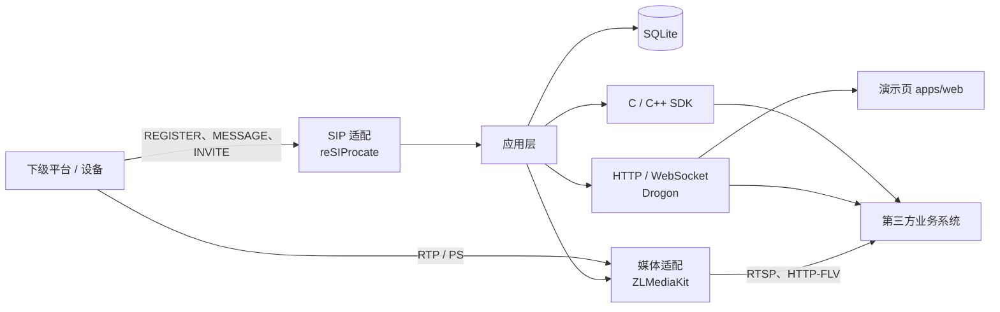

# GB28181 Gateway

**用途：集成到第三方系统中，对接国标平台，实时拉流，再把结果交给业务系统做后续处理。**

本网关基于标准 C++17 和 Bazel，同一套代码在 Windows、Linux 和 macOS 上构建。国标下级平台或设备向本网关注册后，第三方系统通过 HTTP、WebSocket 或 C / C++ SDK 读取目录、发起实时点播，并用返回的 RTSP 或 HTTP-FLV 地址继续做预览、转发或其他业务。后续业务处理在调用方，不在本网关内。

适用于信创系统接入：在国产操作系统和国产 CPU 环境里对接国标平台。实现按标准 C++17 / Bazel 设计，可移植到这些环境。麒麟、统信 UOS 等国产操作系统，以及鲲鹏、飞腾等 arm64 和海光等 x86_64 CPU，本仓库没有实测记录，也没有认证。

[](https://github.com/kay1ess/gb28181-gateway/actions/workflows/build.yml)
[](LICENSE)
[](.bazelrc)
[](MODULE.bazel)
[](#安装包)

文档：[HTTP API](doc/API.md) · [C / C++ SDK](doc/SDK.md) · [演示页](apps/web/README.md)

## 核心特性

下列能力都能在当前代码里找到，信令实现的是 GB/T 28181 的一个子集。

- **跨平台。** Windows x64、Linux x64、Linux arm64、macOS arm64 和 macOS x64 用各自的 Bazel `--config` 从同一套源码构建。安装包带上同一次构建的网关、ZLMediaKit 动态库和 C SDK 共享库。
- **下级接入。** SIP 同时监听 UDP 和 TCP。下级用摘要认证注册，心跳超时后标为离线。多个下级的编码、密码和默认收流方式写入 SQLite。
- **目录汇聚。** 向下级查询 `Catalog`，分批累计后按平台写入目录。进度通过 WebSocket 的 `operation_changed` 推送，条目用 `/api/resources` 分页查询。
- **设备信息与状态。** `DeviceInfo` 和 `DeviceStatus` 先读本地缓存，也可以向下级重新查询。
- **按需实时点播。** `INVITE` 协商 PS（payload 96）。收流支持 UDP、TCP 被动和 TCP 主动。同一通道、同一收流方式共用一路；有 RTSP 或 HTTP-FLV 观看者时保持拉流，空闲超时后停止。按租约续期的旧接口仍然保留。
- **播放地址。** ZLMediaKit 在固定 RTP 端口上按 SSRC 收流，返回 RTSP 和 HTTP-FLV。HTTP-FLV 使用传统 HEVC FLV（Codec ID 12），RTMP 只作为内部封装。运行时关闭 HLS 和 MP4 录像。PS 里的音频轨会保留。
- **三种调用方式。** 业务 HTTP API 使用 Bearer 令牌；WebSocket 推送平台、目录、任务和播放变化；C++ SDK 与 C ABI 动态库供进程内或其他语言绑定使用。
- **演示页。** [apps/web](apps/web/README.md) 是 Vue 3 单页：管理下级、看目录同步进度、查设备，并用内置播放器播放 HTTP-FLV（H.264 / H.265）。RTSP 地址留给其他客户端。

云台、录像检索与回放、报警、语音对讲和向上级联尚未实现。

## 架构

业务层只依赖自有接口。SIP、媒体、存储和 HTTP 都是可替换的适配器。第三方业务系统通过 HTTP、WebSocket 或 SDK 取得目录和实时流地址。



## 快速开始

以下命令在项目根目录执行。需要 **Bazel 9**（`>=9.0.0`、`<10.0.0`）。首次构建要能下载依赖。完整的系统依赖、macOS 目标和配置表见下文。

Windows x64：

```powershell
bazel build --config=windows //apps/server:gateway
Copy-Item -LiteralPath configs/server.example.json -Destination configs/server.local.json
./bazel-bin/apps/server/gateway.exe ./configs/server.local.json
```

Linux x64：

```sh
bazel build --config=linux //apps/server:gateway
cp configs/server.example.json configs/server.local.json
./bazel-bin/apps/server/gateway ./configs/server.local.json
```

macOS 把 `--config` 换成 `macos_arm64` 或 `macos_x64`，可执行文件名是 `gateway`。

启动前改 `configs/server.local.json` 里的 `api_token`。示例值 `replace-this-test-token` 只适合本机测试。局域网接入时把 `advertised_address` 改成这台机器的实际 IPv4。终端出现 `Listening on http://...` 后，服务已在监听，Ctrl+C 结束。

演示页另开一个终端：

```powershell
cd apps/web
npm ci
npm run dev
```

打开 `http://127.0.0.1:5173`，填入同一个 `api_token`。演示页需要 Node.js 22.12 及以上。

## 安装包

[GitHub Actions](https://github.com/kay1ess/gb28181-gateway/actions/workflows/build.yml) 在 Windows x64、Linux x64、Linux arm64、macOS arm64 和 macOS x64 上构建，并把每个平台的压缩包上传为 artifact。推送 `v*` 标签时，同一套包会附到 [Releases](https://github.com/kay1ess/gb28181-gateway/releases)。

每个包包含该次构建的网关可执行文件、ZLMediaKit 动态库（Windows `mk_api.dll`，Linux `libmk_api.so`，macOS `libmk_api.dylib`）、C SDK 共享库、`configs/server.example.json`、本仓库 `LICENSE` 和第三方许可文本。动态库和可执行文件在同一目录，不要拆开。

Linux 包在 `ubuntu-24.04` 或 `ubuntu-24.04-arm` 上链接该系统的 glibc 和 libuuid。这不能说明二进制可以直接在麒麟或统信 UOS 上运行；那些环境要用源码和 Bazel 重新构建。Windows 包需要系统里已有 Microsoft Visual C++ 2015–2022 运行库（x64）。

## 适用场景

- **集成到第三方系统。** 这是本网关的主要用途。业务系统对接国标下级平台，读取目录，实时拉流，再用 RTSP 或 HTTP-FLV 地址做自己的后续处理。
- 本机或局域网核对拉流结果：浏览器走演示页的 HTTP-FLV，其他播放器走 RTSP。
- 进程内集成时使用动态库 `//:sdk_c_shared`，示例在 [examples/sdk](examples/sdk)。

## 和完整国标平台的差别

[WVP-PRO](https://github.com/648540858/wvp-GB28181-pro) 的自述是开箱即用的国标视频平台：Java 实现，自带管理后台，并包含级联、云台、录像和报警等平台能力。本仓库是给第三方系统集成用的 C++ 接入网关：对接国标下级，实时拉流，并把目录和播放地址交给业务侧处理。当前代码覆盖下级注册与保活、目录汇聚、设备信息与状态、按需实时点播，以及 HTTP、WebSocket 和 C / C++ SDK。需要整套平台时选用平台方案。

## 编译

构建要求 **Bazel 9，最低版本为 9.0.0**（`>=9.0.0`、`<10.0.0`）。使用本机安装的 Bazel，通过 `MODULE.bazel`（Bzlmod）管理依赖。

使用 Bazelisk 时，可将环境变量 `USE_BAZEL_VERSION` 设为 `9.x`，自动选择 Bazel 9 系列的最新正式版。

Windows x64 已在 VS 2022 / MSVC 19.42、C++17 下验证，CI 使用 GitHub 托管的 `windows-2022`。需要 Windows SDK、Git Bash、CMake 和 Ninja。首次构建需要网络下载依赖。

```powershell
bazel build --config=windows //apps/server:gateway
```

Linux x64：

```sh
bazel build --config=linux //apps/server:gateway
```

macOS 原生编译使用 Apple Clang、macOS SDK、CMake 和 Ninja。Apple Silicon Mac 执行：

```sh
xcrun --sdk macosx --show-sdk-path
bazel build --config=macos_arm64 //apps/server:gateway //:sdk_c_shared
bazel test --config=macos_arm64 //tests:storage_test //tests:sdk_test //tests:c_api_test
```

Intel Mac 把 `macos_arm64` 换成 `macos_x64`。CI 的 Apple Silicon runner 是 `macos-15`，Intel runner 是 `macos-15-intel`。

Linux arm64 原生构建（aarch64 主机，例如 GitHub 托管的 `ubuntu-24.04-arm`）：

```sh
bazel build --config=linux_aarch64 //apps/server:gateway //:sdk_c_shared
```

`--config=linux_arm64` 仍是在 Linux x64 上用 Debian 交叉工具链编译 Linux ARM64，需要本机已装好 `aarch64-linux-gnu` 编译器和 QEMU。它和上面的原生配置不是同一条命令。CI 跑的是原生配置，不跑这条交叉编译。

不传 `--config` 时使用当前系统的默认配置。编译结果为 `bazel-bin/apps/server/gateway.exe`（Linux 和 macOS 为 `gateway`）。运行时保留同次构建的 ZLMediaKit 动态库，Windows 为 `mk_api.dll`，Linux 为 `libmk_api.so`，macOS 为 `libmk_api.dylib`。

## 配置

```powershell
Copy-Item -LiteralPath configs/server.example.json -Destination configs/server.local.json
```

按实际环境修改 `configs/server.local.json`：

| 配置项               | 示例值                 | 说明                                                           |
| -------------------- | ---------------------- | -------------------------------------------------------------- |
| `server_gb_id`       | `34020000002000000001` | 本级 20 位国标编码                                             |
| `realm`              | `3402000000`           | 10 位 SIP 认证域                                               |
| `bind_address`       | `127.0.0.1`            | SIP、业务 HTTP 和 RTP 的监听地址                               |
| `advertised_address` | `127.0.0.1`            | 下级和播放器能访问的 IPv4，不要填 `0.0.0.0`                    |
| `sip_port`           | `5060`                 | SIP 端口                                                       |
| `http_port`          | `8080`                 | 业务 API 和 WebSocket                                          |
| `rtp_port`           | `10000`                | 各路共用的 RTP 端口，RTCP 使用下一端口。`0` 表示启动时自动选择 |
| `media_rtsp_port`    | `8554`                 | RTSP 播放端口。`0` 表示自动分配                                |
| `media_http_port`    | `8081`                 | HTTP-FLV 播放端口。`0` 表示自动分配                            |
| `database_path`      | `gb28181.db`           | 相对进程工作目录，父目录必须已存在且可写                       |
| `api_token`          | 自行设置               | 16–256 字符，请求头 `Authorization: Bearer <api_token>`        |
| `query_timeout_ms`   | `10000`                | 目录查询超时                                                   |
| `media_timeout_ms`   | `10000`                | 点播等待媒体就绪的超时                                         |
| `lease_seconds`      | `60`                   | 旧租约模式的有效期，取地址接口单独设置无人拉流超时             |
| `max_playbacks`      | `64`                   | 同时播放上限                                                   |

本机调试可保留 `127.0.0.1`。局域网接入时，把 `advertised_address` 改成这台机器的实际地址。端口被占用时启动失败，不会自动换端口。

## 启动

```powershell
./bazel-bin/apps/server/gateway.exe ./configs/server.local.json
```

在项目根目录启动，这样 `database_path` 等相对路径才指向项目内的文件。`bazel run` 的工作目录不是项目根，相对配置路径会报 `Invalid configuration file`。

进程会停在终端里，看到 `Listening on http://...` 就是已经在服务。Ctrl+C 结束。

演示页面在 [apps/web](apps/web/README.md)。服务启动后另开终端：

```powershell
cd apps/web
npm ci
npm run dev
```

打开 `http://127.0.0.1:5173`，填入配置中的 `api_token`。
