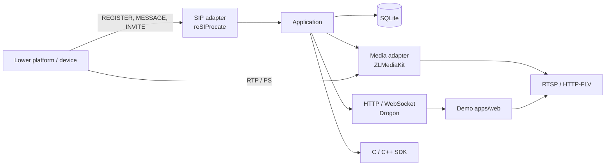

# GB28181 Gateway

[中文](README.md)

A C++17 / Bazel gateway for GB/T 28181. It accepts lower platforms, stores their catalogs, and pulls live video on demand as RTSP and HTTP-FLV. Callers use HTTP, WebSocket, or the C / C++ SDK.

[](LICENSE)
[](.bazelrc)
[](MODULE.bazel)
[](README.md#编译)

Docs: [HTTP API](doc/API.md) · [C / C++ SDK](doc/SDK.md) · [Web demo](apps/web/README.md)

<!--
Screenshot / demo GIF: add the file under doc/images/, then replace the note
below with a real image link, for example:

Do not add that link before the file exists.
-->

> **Screenshot / demo GIF is not in the repository yet.** A console capture (platform tree and HTTP-FLV preview), or a short GIF from registration through the first picture, can replace this note. Put the file in `doc/images/`.

## Features

These are implemented in the tree today. The SIP surface is a subset of GB/T 28181.

- **Lower platforms.** SIP listens on UDP and TCP. Registration uses digest authentication, and a missed heartbeat marks the platform offline. Platform id, password, and default receive mode are stored in SQLite.
- **Catalog.** A `Catalog` query is assembled from batches and stored per platform. Progress is pushed as WebSocket `operation_changed`; rows are read from `/api/resources`.
- **Device info and status.** `DeviceInfo` and `DeviceStatus` are cached and can be refreshed from the lower platform.
- **On-demand live video.** `INVITE` negotiates PS (payload 96) over UDP, TCP passive, or TCP active. The same channel and receive mode share one stream. Viewers on RTSP or HTTP-FLV keep it up; an idle timeout tears it down. The older lease API is still available.
- **Playback URLs.** ZLMediaKit receives every stream on one RTP port and demuxes by SSRC. It publishes RTSP and HTTP-FLV. HTTP-FLV uses legacy HEVC FLV (codec id 12); RTMP is only the internal container. HLS and MP4 recording are turned off at runtime. Audio tracks inside the PS stream are kept.
- **Three APIs.** Bearer-token HTTP, a WebSocket event stream, and a C++ SDK plus a C ABI shared library.
- **Web demo.** [apps/web](apps/web/README.md) is a Vue 3 page for platforms, catalog sync, device details, and HTTP-FLV playback (H.264 / H.265). The RTSP URL is left for other players.

PTZ, record search and playback, alarms, two-way audio, and upward cascade are not implemented.

## Architecture

The application depends only on its own ports. SIP, media, storage, and HTTP are adapters.



## Quick start

Run these from the repository root. You need **Bazel 9** (`>=9.0.0`, `<10.0.0`). The first build downloads dependencies. Host packages, the macOS targets, and the full configuration table are in the [Chinese README](README.md#编译).

Windows x64:

```powershell
bazel build --config=windows //apps/server:gateway
Copy-Item -LiteralPath configs/server.example.json -Destination configs/server.local.json
./bazel-bin/apps/server/gateway.exe ./configs/server.local.json
```

Linux x64:

```sh
bazel build --config=linux //apps/server:gateway
cp configs/server.example.json configs/server.local.json
./bazel-bin/apps/server/gateway ./configs/server.local.json
```

On macOS use `--config=macos_arm64` or `--config=macos_x64`. The binary is `bazel-bin/apps/server/gateway`.

Set `api_token` in `configs/server.local.json` before starting. The sample value `replace-this-test-token` is for local testing only. For a LAN device, set `advertised_address` to an IPv4 address that the device and players can reach. `Listening on http://...` means the process is serving. Ctrl+C stops it.

The demo page, in another terminal, needs Node.js 22.12 or newer:

```powershell
cd apps/web
npm ci
npm run dev
```

Open `http://127.0.0.1:5173` and enter the same `api_token`.

## When to use it

- An existing service needs GB/T 28181 catalogs and live URLs over HTTP or the C SDK.
- You want a local or LAN preview: HTTP-FLV in the browser, RTSP in another player.
- You want the gateway inside an existing C or C++ process. The shared library target is `//:sdk_c_shared`. Samples live in [examples/sdk](examples/sdk).

## Compared with a full platform

[WVP-PRO](https://github.com/648540858/wvp-GB28181-pro) describes itself as a ready-to-run GB28181 video platform: Java, an admin UI, plus cascade, PTZ, recording, and alarms. This repository is a C++ access gateway. The code covers lower-platform registration and keepalive, catalog aggregation, device info and status, on-demand live video, and HTTP, WebSocket, and C / C++ SDKs. Use a full platform when you need that product. Start here when you want the access layer inside a system you already have.

## License

Original code in this repository is under the [MIT License](LICENSE), copyright kay1ess, 2026.

Third-party components keep their own licenses. The gateway build links reSIProcate, Drogon, ZLMediaKit, SQLite, TinyXML2, JsonCpp, and zlib. ZLMediaKit adds a requirement to keep the “ZLMediaKit” token in its service identifiers. The demo player in `apps/web/vendor/smsplayer` is ISC, and its WASM contains FFmpeg; see `licenses/` in that directory. Keep those notices when you ship a binary or the demo page.
